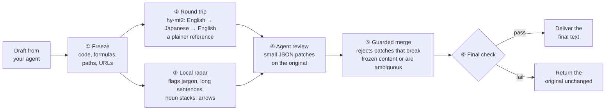

<div align="center">

# no-ai-fluff

### The AI-dialect remover for your coding agent

**Less machine posture. More plain talk.**

[中文](README.md) · English

<!-- TODO(author): drag promo/no-ai-fluff-en.mp4 into the GitHub web editor, then replace both VIDEO_URL_EN below with the https://github.com/user-attachments/assets/... link -->
[](VIDEO_URL_EN)

▶ [Watch the 2:43 promo](VIDEO_URL_EN)

[](LICENSE)


</div>

---

## What it does

You know every word in an AI status update, yet it reads like a telegram: "drove alignment", "unlocked a step-function improvement", "de-risked the runway". Nouns pile up, arrows replace "because" and "then", and you have to unpack every sentence yourself.

**no-ai-fluff rewrites that dialect into plain English before it reaches a person.** It plugs into Claude Code and other MCP-capable agents: your session writes as usual, hands the draft to no-ai-fluff, and gets a final version back. Code, formulas, paths and numbers stay exactly as they were.

### Before and after

> **Original** (a demo paragraph written for this README)
>
> This sprint, we drove alignment across the identity platform workstream and landed a holistic token-validation path consolidation for `auth-gateway`, unlocking a step-function improvement in tail-latency posture: p99 moved from 120ms to 45ms. Leveraging a Redis-backed session-introspection caching layer rolled out across 2 regions, the change de-risks the downstream consumer migration runway and positions us to double-click on partner-facing SLA commitments next quarter. Net-net: a north-star-aligned win that meaningfully moves the needle on platform trust.

> **After no-ai-fluff** (actual output: 3 edits, 0 rejected)
>
> This sprint, we aligned work across the identity platform workstream and shipped a consolidated token-validation path for `auth-gateway`. That change cut tail latency: p99 moved from 120ms to 45ms. The change uses a Redis-backed caching layer for session introspection that is deployed in 2 regions. The change reduces the risk of migrating downstream consumers and positions us to focus on our SLA commitments to partners next quarter. This is a win that supports our main goal and improves platform trust.

14 jargon phrases → 0. Average sentence length 24 → 15.6 words. `auth-gateway`, `p99`, `120ms → 45ms` and `2 regions` untouched.

### Why AI writes like this

Clark, Martin & Mahowald (2026), *[Why is AI-generated language so hard to understand?](https://arxiv.org/html/2610.29162v1)*, found that the more post-training a model gets, the more hard-to-read constructions it uses; that RL with a length penalty pushes a model toward shorter, denser phrasing; and that translating text into another language and back keeps the meaning while dropping much of that phrasing.

no-ai-fluff turns that round trip into a tool. A round trip can drift, so the translated version is only a reference: your agent makes small, targeted edits on the original.

### How it works



Your agent sees two MCP tools:

```
prepare_rtt_draft(text)                  → draft_id, original, round-trip reference, radar hints, editing rules
finalize_patched_delivery(id, patches)   → final text
```

The editing is done by the model your agent is already signed in with, in its own sub-context, so it doesn't crowd your main session. no-ai-fluff itself only calls one small, cheap translation model.

---

## Install

### Recommended: let your agent install it

Paste this into Claude Code (or any agent that can run shell commands):

```text
Please install the English edition of no-ai-fluff in this project by following
https://github.com/ConstantlyGrowup/no-ai-fluff/blob/main/docs/agent-setup.md
and help me set up the translation API key.
```

Your agent installs the CLI, registers the MCP server, adds the reviewer subagent and the `/no-ai-fluff-en` command, asks you for an API key and writes it to `.env`. It finishes by running a sample through the round trip to confirm the key works.

### You need one API key

The translation model, hy-mt2, is available from two providers. **We recommend OpenRouter.**

| | OpenRouter (recommended) | Tencent Cloud TokenHub (fallback) |
|---|---|---|
| Model | `tencent/hy-mt2-30b-a3b` | `hy-mt2-pro` |
| Environment variable | `OPENROUTER_API_KEY` | `TENCENTCLOUD_API_KEY` |
| Limits | 8 parallel requests by default; no rate limiting seen in our evaluation | 60 calls per minute by default; about 1,200 characters per call, so long documents take more calls |
| Cost | about $0.002 per document for the round trip (measured on 30 test documents) | per Tencent Cloud pricing |

If both keys are set, OpenRouter is used. If only the Tencent Cloud key is set, it is used automatically.

**Get an OpenRouter key**

<!-- TODO(author): add 2–3 screenshots: sign up, add credits, create a key -->
> 📷 Screenshots coming: sign up at OpenRouter → add credits → create a key at <https://openrouter.ai/keys>

### Manual install

Python 3.10 or newer, no third-party runtime dependencies.

```bash
pip install "git+https://github.com/ConstantlyGrowup/no-ai-fluff.git"
no-ai-fluff-en install claude-code            # subagent, /no-ai-fluff-en and .mcp.json in this project
echo "OPENROUTER_API_KEY=sk-or-..." >> .env    # keep .env out of git
```

Restart Claude Code and approve the `no-ai-fluff-en` MCP server. After a long reply or document, type `/no-ai-fluff-en` or just say "finalize this with no-ai-fluff".

> Review quality depends on reasoning effort. In our tests, low effort missed factual errors in 5 of 5 documents; high effort missed them in 1. Run the reviewer subagent with high effort.

<details>
<summary>CLI, settings and Python API</summary>

```bash
no-ai-fluff-en run draft.md -o out.md                # round trip only (no patches)
no-ai-fluff-en prepare draft.md > prep.json          # first call
no-ai-fluff-en finalize <draft_id> --patches p.json  # second call; patches as a file, - or inline JSON
no-ai-fluff-en radar draft.md                        # local radar only
no-ai-fluff-en mcp                                   # stdio MCP server
claude mcp add no-ai-fluff-en -- no-ai-fluff-en mcp  # register the MCP server only
```

| Variable | Default | Meaning |
|---|---|---|
| `NO_AI_FLUFF_EN_PROVIDER` | auto | `openrouter` or `tencent`; unset means OpenRouter if its key exists, otherwise Tencent Cloud |
| `NO_AI_FLUFF_EN_MODEL` | provider default | `tencent/hy-mt2-30b-a3b` on OpenRouter, `hy-mt2-pro` on Tencent Cloud |
| `NO_AI_FLUFF_EN_BRIDGE` | `ja` | bridge language for the round trip |
| `NO_AI_FLUFF_EN_CHAT_TIMEOUT` / `_DOC_TIMEOUT` | `10` / `60` | round-trip time budget in seconds (chat reply / document) |
| `NO_AI_FLUFF_TENCENT_RPM` | `60` | Tencent Cloud calls per minute (client-side limiter) |
| `NO_AI_FLUFF_TELEMETRY` | `1` | `0` turns off local statistics (counts only, never text) |

```python
from no_ai_fluff.en.pipeline import EnPipeline

pipe = EnPipeline()
prep, fin = pipe.run(draft, reviewer=lambda prompt: my_llm(prompt))  # reviewer returns JSON patches
print(fin.final_text)
```

There is also a Chinese edition, `no-ai-fluff` (Chinese → Russian → Chinese). See the [Chinese README](README.md).

</details>

---

## Evaluation

no-ai-fluff was first built and evaluated for Chinese: 76 real long-form AI replies, split into 22 training, 24 tuning and 30 sealed test documents. The test set stayed locked until tuning was over and was scored once. The judge is an independent model, JEV (`typesafe/jev-1.14`), which rates every pair twice with A and B swapped and averages the two; we also ran a human blind test. The numbers below are from that Chinese evaluation.

### Easier to read than the original

On the 30 sealed test documents, **27 read better after editing, a 63.7% win rate against the original**. In a human blind test that put the original, no-ai-fluff and Humanizer-zh side by side, **no-ai-fluff was picked as the easiest to read 87.5% of the time**.

| Category | Win rate vs. the original AI text |
|---|---|
| Writing (proposals, weekly reports) | **74.6%** |
| Coding (PR summaries, change notes) | **69.9%** |
| Technical explanations | **64.6%** |
| Math and algorithm derivations | **60.0%** |
| Discussion (trade-offs, tech choices) | 58.9% |
| Everyday questions | 54.0% |

### Code and formulas stay intact

| | no-ai-fluff | Humanizer-zh |
|---|---|---|
| Code, paths, formulas and URLs kept verbatim | **100% in every document** | 99.1%; 88.9% in the worst document |
| Documents with a changed number | 1 (a duplicated aside removed; no value changed) | 2 |

### Less jargon, fewer compressed sentences

| Metric | Original | Humanizer-zh | no-ai-fluff |
|---|---|---|---|
| 6 common Chinese buzzwords | 17 | 15 | **0** |
| Arrows used instead of connectives (`A → B → C`) | 16 | 14 | **2** |

The first row counts 54 tuning and test documents; the second counts the 30 test documents.

### Compared with Humanizer-zh

[Humanizer-zh](https://github.com/op7418/Humanizer-zh) is a widely used Chinese de-AI skill (22k+ GitHub stars). Run on the same model, the two come out **about even overall, with no-ai-fluff slightly ahead (51.2%)**: no-ai-fluff leads on coding, technical explanations and mixed math/code text, while Humanizer-zh does better on writing, discussion and everyday questions. Humanizer-zh rewrites the whole text; no-ai-fluff only edits what is hard to read, which makes it safer on text full of code, formulas and terms.

Full records:

- [Evaluation report](docs/evaluation-report.md) (Chinese): setup, confidence intervals, per-category results, latency and cost, limitations
- [Translator and bridge-language study](docs/rtt-model-comparison.md) (Chinese)
- [Tuning ledger](benchmarks/optimization_ledger.jsonl): every change and its result
- [English edition evaluation notes](docs/english-evaluation-report.md) (Chinese)

### Limitations

- **The headline numbers come from Chinese.** The English edition was tuned and checked on a small locked set with the same model judge; there has been no blind test with native English readers yet.
- **Math-heavy English text is not a strength yet.** On formula-heavy explanations, the judge preferred the original English text.
- **It is slower than a one-shot rewrite**: one extra round trip plus the agent's patches. On the Chinese test set the median end-to-end time was about 71 s (Humanizer-zh: about 34 s).
- Very short replies can hit the 10-second round-trip budget; the original is then returned unchanged.

---

## Learn more

- [Architecture](docs/architecture.md) · [Setup guide for agents](docs/agent-setup.md) · [Writing principles (SKILL.md)](SKILL.md)
- Paper: Clark, Martin & Mahowald, 2026, *Why is AI-generated language so hard to understand?* ([arXiv 2610.29162](https://arxiv.org/html/2610.29162v1))

If it saved you from a paragraph of "net-net", a ⭐ helps others find it.

## License

MIT
