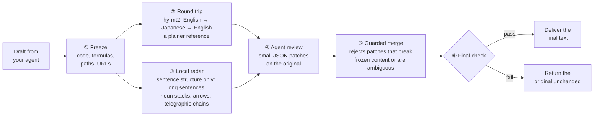

<div align="center">

# no-ai-fluff

### The AI-dialect remover for your coding agent

**Less machine posture. More plain talk.**

[中文](README.md) · English

<!-- TODO(author): drag promo/no-ai-fluff-en.mp4 into the GitHub web editor, then replace both VIDEO_URL_EN below with the https://github.com/user-attachments/assets/... link -->
[](VIDEO_URL_EN)

▶ [Watch the 2:43 promo](VIDEO_URL_EN)

[](LICENSE)


</div>

---

## What it does

You know every word in an AI status update, yet it reads like a telegram: "drove alignment", "unlocked a step-function improvement", "de-risked the runway". Nouns pile up, arrows replace "because" and "then", and you have to unpack every sentence yourself.

**no-ai-fluff rewrites that dialect into plain English before it reaches a person.** It plugs into Claude Code and other MCP-capable agents: your session writes as usual, hands the draft to no-ai-fluff, and gets a final version back. Code, formulas, paths and numbers stay exactly as they were.

### Before and after

> **Original** (a demo paragraph written for this README)
>
> This sprint, we drove alignment across the identity platform workstream and landed a holistic token-validation path consolidation for `auth-gateway`, unlocking a step-function improvement in tail-latency posture: p99 moved from 120ms to 45ms. Leveraging a Redis-backed session-introspection caching layer rolled out across 2 regions, the change de-risks the downstream consumer migration runway and positions us to double-click on partner-facing SLA commitments next quarter. Net-net: a north-star-aligned win that meaningfully moves the needle on platform trust.

> **After no-ai-fluff** (actual output of the current default rules: 3 edits, 0 rejected)
>
> This sprint, we coordinated work across the identity platform workstream and shipped a consolidated token-validation path for `auth-gateway`. As a result, tail latency improved: p99 moved from 120ms to 45ms. The change uses a Redis-backed caching layer for session introspection that was rolled out across 2 regions. It reduces risk in the downstream consumer migration and positions us to look closely at our SLA commitments to partners next quarter. In short, this improves platform trust.

14 jargon phrases → 0. Average sentence length 24 → 14.6 words. `auth-gateway`, `p99`, `120ms → 45ms` and `2 regions` untouched.

### Why AI writes like this

Clark, Martin & Mahowald (2026), *[Why is AI-generated language so hard to understand?](https://arxiv.org/html/2610.29162v1)*, found that the more post-training a model gets, the more hard-to-read constructions it uses; that RL with a length penalty pushes a model toward shorter, denser phrasing; and that translating text into another language and back keeps the meaning while dropping much of that phrasing.

no-ai-fluff turns that round trip into a tool. A round trip can drift, so the translated version is only a reference: your agent makes small, targeted edits on the original.

### How it works



Your agent sees two MCP tools:

```
prepare_rtt_draft(text)                  → draft_id, original, round-trip reference, radar hints, editing rules
finalize_patched_delivery(id, patches)   → final text
```

The local radar has no built-in jargon list. It only looks at sentence structure:

- long sentences;
- noun stacks and buried verbs;
- symbols standing in for words;
- "telegraphic chains": a sentence cut into short phrases with almost no function words.

When the radar finds a telegraphic chain, `prepare_rtt_draft` first asks your agent one extra question: do these sentences come from a technical context? Your agent answers with a second call that passes `draft_id` and `domain_triage`. In a technical context it gets the stronger rules back; otherwise, the base rules. The answer comes from your agent's own model. The round trip is not repeated, and ordinary drafts never get this step.

The editing is done by the model your agent is already signed in with, in its own sub-context, so it doesn't crowd your main session. no-ai-fluff itself only calls one small, cheap translation model.

### The radar checks sentence structure, not a hard-coded jargon list

- **Compressed AI prose is a syntactic pattern.** Clark et al. (2026) found that post-training, especially reinforcement learning with a length penalty, pushes models toward shorter, denser phrasing. In our corpora that shows up in three ways:
  - function words and connectives are dropped;
  - multi-step reasoning is squeezed into `→` chains or bare fragments;
  - in English, actions get buried in -tion and -ment nouns under stacked modifiers.
- **Readers have to rebuild the logic themselves.** Under the uniform information density (UID) hypothesis from psycholinguistics, function words and connectives spread information evenly. When they go missing and a sentence breaks into fragments, readers must supply "because", "then" and "so" from working memory.
- **So the radar measures the skeleton.** Fragment count, fragment length and function-word share cost nothing to measure and hold across domains. For example, an English sentence of at least 12 words, cut into 3 or more phrases of 3–8 words on average, with function words at or below 30%, is flagged as a telegraphic chain.
- **Jargon itself goes to the round trip and the host.** Jargon keeps changing, so a word list never catches up. And a list that both drives the edits and scores them only measures itself. Genuine terms survive the round trip almost unchanged, while coined jargon tends to come back as plain words; the host model decides from there.

See [Architecture](docs/architecture.md) (Chinese) and [Internalized rules](docs/internalized-rules.md) (Chinese, with an English summary).

---

## Install

### Recommended: let your agent install it

Paste this into Claude Code (or any agent that can run shell commands):

```text
Please install the English edition of no-ai-fluff in this project by following
https://github.com/ConstantlyGrowup/no-ai-fluff/blob/main/docs/agent-setup.md
and help me set up the translation API key.
```

Your agent installs the CLI, registers the MCP server, adds the reviewer subagent and the `/no-ai-fluff-en` command, asks you for an API key and writes it to `.env`. It finishes by running a sample through the round trip to confirm the key works.

It works the same if you are not on Claude Code. The setup guide has the agent work out which product it is (Codex, Qoder, WorkBuddy, ZCode, DeepSeek Harness, etc.), install the portable skill where that agent reads skills, and add a short section to `AGENTS.md`.

### You need one API key

The translation model, hy-mt2, is available from two providers. **We recommend OpenRouter.**

| | OpenRouter (recommended) | Tencent Cloud TokenHub (fallback) |
|---|---|---|
| Model | `tencent/hy-mt2-30b-a3b` | `hy-mt2-pro` |
| Environment variable | `OPENROUTER_API_KEY` | `TENCENTCLOUD_API_KEY` |
| Limits | 8 parallel requests by default; no rate limiting seen in our evaluation | 60 calls per minute by default; about 1,200 characters per call, so long documents take more calls |
| Cost | about $0.002 per document for the round trip (measured on 30 test documents) | per Tencent Cloud pricing |

If both keys are set, OpenRouter is used. If only the Tencent Cloud key is set, it is used automatically.

**Get an OpenRouter key**

<!-- TODO(author): add 2–3 screenshots: sign up, add credits, create a key -->
> 📷 Screenshots coming: sign up at OpenRouter → add credits → create a key at <https://openrouter.ai/keys>

### Manual install

Python 3.10 or newer, no third-party runtime dependencies.

```bash
pip install "git+https://github.com/ConstantlyGrowup/no-ai-fluff.git"
no-ai-fluff-en install claude-code            # subagent, /no-ai-fluff-en and .mcp.json in this project
echo "OPENROUTER_API_KEY=sk-or-..." >> .env    # keep .env out of git
```

Restart Claude Code and approve the `no-ai-fluff-en` MCP server. After a long reply or document, type `/no-ai-fluff-en` or just say "finalize this with no-ai-fluff".

For other agents, replace the second line with the matching command, then register the MCP server in that agent (stdio, command `no-ai-fluff-en`, argument `mcp`):

| Agent | Command | Skill goes to |
|---|---|---|
| Codex | `no-ai-fluff-en install codex`, then `codex mcp add no-ai-fluff-en -- no-ai-fluff-en mcp` | `.agents/skills/`, plus a section in `AGENTS.md` |
| ZCode | `no-ai-fluff-en install zcode` | `.agents/skills/`, plus a section in `AGENTS.md` |
| Qoder | `no-ai-fluff-en install qoder` | `.qoder/skills/`, plus a section in `AGENTS.md` |
| WorkBuddy | `no-ai-fluff-en install workbuddy` | `~/.workbuddy/skills/` (user level only) |
| DeepSeek Harness and others | `no-ai-fluff-en install generic` | `.agents/skills/`, plus a section in `AGENTS.md` |

> Review quality depends on reasoning effort. In our tests, low effort missed factual errors in 5 of 5 documents; high effort missed them in 1. Run the reviewer subagent with high effort.

<details>
<summary>CLI, settings and Python API</summary>

```bash
no-ai-fluff-en run draft.md -o out.md                # round trip only (no patches)
no-ai-fluff-en prepare draft.md > prep.json          # first call
no-ai-fluff-en finalize <draft_id> --patches p.json  # second call; patches as a file, - or inline JSON
no-ai-fluff-en radar draft.md                        # local radar only
no-ai-fluff-en mcp                                   # stdio MCP server
claude mcp add no-ai-fluff-en -- no-ai-fluff-en mcp  # register the MCP server only
```

| Variable | Default | Meaning |
|---|---|---|
| `NO_AI_FLUFF_EN_PROVIDER` | auto | `openrouter` or `tencent`; unset means OpenRouter if its key exists, otherwise Tencent Cloud |
| `NO_AI_FLUFF_EN_MODEL` | provider default | `tencent/hy-mt2-30b-a3b` on OpenRouter, `hy-mt2-pro` on Tencent Cloud |
| `NO_AI_FLUFF_EN_BRIDGE` | `ja` | bridge language for the round trip |
| `NO_AI_FLUFF_EN_RULES` | `en5` (= `v2`) | editing rules: `v2` / `en5` is the structure radar with domain triage; `v1` / `en2` is the first-generation single channel |
| `NO_AI_FLUFF_EN_CHAT_TIMEOUT` / `_DOC_TIMEOUT` | `10` / `60` | round-trip time budget in seconds (chat reply / document) |
| `NO_AI_FLUFF_TENCENT_RPM` | `60` | Tencent Cloud calls per minute (client-side limiter) |
| `NO_AI_FLUFF_TELEMETRY` | `1` | `0` turns off local statistics (counts only, never text) |

```python
from no_ai_fluff.en.pipeline import EnPipeline

pipe = EnPipeline()
prep, fin = pipe.run(draft, reviewer=lambda prompt: my_llm(prompt))  # reviewer returns JSON patches
print(fin.final_text)
```

There is also a Chinese edition, `no-ai-fluff` (Chinese → Russian → Chinese). See the [Chinese README](README.md).

</details>

### Using it in conversation

Once it is installed, there are two ways to have your agent pass a draft through no-ai-fluff:

- **Option A · slash command**: after a reply or document is written in Claude Code, type `/no-ai-fluff-en`, or `/no-ai-fluff-en path/to/doc.md` for a file.
- **Option B · just ask**: add "run it through no-ai-fluff at the end" to your request, or ask afterwards, for example "Use no-ai-fluff to finalize docs/design.md". In Cursor, Codex and other MCP-capable clients it works the same way: the agent calls the `prepare_rtt_draft` and `finalize_patched_delivery` tools itself.

If a paragraph of the final text still reads too dense, you can name it and have the agent rewrite just that paragraph. The note and the rewrite rules are in the skill and the `AGENTS.md` section, and they also come back with every `finalize_patched_delivery` result, so agents without skill support follow them too. An illustrative conversation:

> **Turn 1: the normal pass**
>
> **You**: Write the sprint update for the auth-gateway work, and run it through no-ai-fluff at the end.
>
> **Agent**: (writes the draft as usual, then hands it to no-ai-fluff: a round trip gives a plainer reference, only the hard-to-read sentences get small edits on the original, a program checks code and numbers, and the final text comes back)
>
> This sprint, we coordinated work across the identity platform workstream and shipped a consolidated token-validation path for `auth-gateway`. As a result, tail latency improved: p99 moved from 120ms to 45ms. The change uses a Redis-backed caching layer for session introspection that was rolled out across 2 regions. It reduces risk in the downstream consumer migration and positions us to look closely at our SLA commitments to partners next quarter. In short, this improves platform trust.
>
> For legacy clients, a graceful-degradation fallback path is now operationalized behind contract gating, with the error rate holding under `0.1%`.
>
> ---
>
> If any paragraph still feels dense or jargon-heavy and needs a full rewrite instead of light edits, just tell me which part to rewrite in plain English (or paste those sentences). I will rewrite only that part from scratch and keep all code, paths, formulas and numbers untouched.

> **Turn 2: rewrite one paragraph**
>
> **You**: The second paragraph about legacy clients is still too dense. Rewrite it in plain English, and keep the numbers as they are.
>
> **Agent**: (uses the built-in rewrite rules on paragraph 2 only; paragraph 1 and every code span and number stay as they were)
>
> Older clients now fall back to a simpler, compatible behavior. A contract check sits in front of that fallback, and the error rate on it stays under `0.1%`.

Paragraph 1 is the real output shown in "Before and after" above; paragraph 2 and the turn-2 rewrite were written for this example. The rewrite only happens when you ask for it, and its rules ship in the `/no-ai-fluff-en` command installed into your project: change only what you name, keep code, formulas and numbers exactly, and add nothing the original did not say.

---

## Evaluation

no-ai-fluff was first built and evaluated for Chinese: 76 real long-form AI replies, split into 22 training, 24 tuning and 30 sealed test documents. Rules were designed and chosen on the training, tuning and probe sets only; the sealed set stayed locked until tuning was over. It has been scored twice: once for the first-generation rules (v8), and once for the current second-generation default (v16).

Unless noted, the numbers below are the second generation on that sealed Chinese set (`benchmarks/results/holdout-v16`). The judge is an independent model, JEV (`typesafe/jev-1.14`), which rates every pair twice with A and B swapped and averages the two; we also ran a human blind test.

### At a glance

| Sealed Chinese test set, 30 documents | Original | Humanizer-zh | no-ai-fluff |
|---|---|---|---|
| Win rate against the original | – | 60.2% | **65.2%** (95% CI 61.3%–69.0%) |
| Documents that read better than the original | – | 24 / 30 | **27 / 30** |
| Readability (1–5) | 4.03 | 4.06 | **4.11** |
| AI-tone probability (lower is better) | 0.451 | **0.397** | 0.424 |
| Fidelity risk (lower is better) | – | 0.570 | **0.526** |

The overall reward R is **0.656** (95% CI 0.632–0.681), up from 0.641 for the first generation. The paired difference CI is +0.001 to +0.032: it does not cross zero, but only just.

### Easier to read than the original

On the 30 sealed test documents, **27 read better after editing, a 65.2% win rate against the original**. In a human blind test that put the original, no-ai-fluff and Humanizer-zh side by side, **no-ai-fluff was picked as the easiest to read 87.5% of the time**.

| Category | Win rate vs. the original AI text |
|---|---|
| Writing (proposals, weekly reports) | **77.2%** |
| Coding (PR summaries, change notes) | **71.6%** |
| Technical explanations | **67.8%** |
| Discussion (trade-offs, tech choices) | **60.3%** |
| Math and algorithm derivations | **60.0%** |
| Everyday questions | 54.0% |

### Code and formulas stay intact

| | no-ai-fluff | Humanizer-zh |
|---|---|---|
| Code, paths, formulas and URLs kept verbatim | **100% in every document** | 99.1%; 88.9% in the worst document |
| Documents with a changed number | 1 (a duplicated aside removed; no value changed) | 2 |

### Jargon counts: a side observation only

The runtime radar no longer carries a jargon word list. Counting "jargon removed" with that same list would only grade the tool against its own checklist, so the counts below are a rough side observation, not a score. Quality is judged by blind win rates, readability and fidelity risk.

| Side observation | Original | Humanizer-zh | no-ai-fluff |
|---|---|---|---|
| 6 common Chinese buzzwords | 17 | 15 | 1 |
| Arrows used instead of connectives (`A → B → C`) | 16 | 14 | 5 |

The first row counts 54 tuning and test documents; the second counts the 30 test documents. The first-generation radar named each listed buzzword, and the two rows were 0 and 2. The second generation does not, so most typical packaging words disappear through the round trip and the host's judgment, with no guarantee of zero.

### English edition

The English edition was tuned on 13 documents and checked on a locked set of 12: 4 real Claude Code PRs and 8 assistant answers (`benchmarks/results/en-test-en5`). Same JEV judge, no human blind test yet.

| Locked English test set, 12 documents | Original | no-ai-fluff |
|---|---|---|
| Win rate against the original | – | **63.1%** (9 of 12 documents) |
| On the 4 real Claude Code PRs | – | **71.6%** |
| Readability (1–5) | 3.95 | **4.13** |
| AI-tone probability | 0.30 | **0.253** |
| Sentences over 30 words | 10.6% | **1.04%** |
| Average sentence length | 16.3 words | **13.3 words** |
| Patches applied / rejected | – | 54 / 1 |
| Documents with a changed number / fallbacks | – | 0 / 0 |

Head to head against the first-generation English rules (en2), the current rules (en5) win 51.9% on this set (6 wins, 3 losses, 3 ties) and 57.5% on the tune set (7 wins, 2 losses, 4 ties). The gains are small, and not uniform: on the real PRs en2 scored higher (75.4%).

### Compared with Humanizer-zh

[Humanizer-zh](https://github.com/op7418/Humanizer-zh) is a widely used Chinese de-AI skill (22k+ GitHub stars). Run on the same model, **no-ai-fluff comes out ahead: a 53.9% win rate (95% CI 49.1%–58.8%), ahead on 19 of 30 documents**.

no-ai-fluff leads on coding, technical explanations, writing and mixed math/code text, while Humanizer-zh does better on discussion and everyday questions. no-ai-fluff's fidelity risk is lower (0.526 against 0.570), and its AI-tone probability is slightly higher (0.424 against 0.397).

Humanizer-zh rewrites the whole text; no-ai-fluff only edits what is hard to read, which makes it safer on text full of code, formulas and terms.

Full records:

- [Evaluation report](docs/evaluation-report.md) (Chinese): setup, confidence intervals, per-category results, latency and cost, limitations
- [Translator and bridge-language study](docs/rtt-model-comparison.md) (Chinese)
- [Tuning ledger](benchmarks/optimization_ledger.jsonl): every change and its result
- [English edition evaluation notes](docs/english-evaluation-report.md) (Chinese)

---

## Learn more

- [Architecture](docs/architecture.md) · [Internalized rules](docs/internalized-rules.md) · [Setup guide for agents](docs/agent-setup.md)
- Paper: Clark, Martin & Mahowald, 2026, *Why is AI-generated language so hard to understand?* ([arXiv 2610.29162](https://arxiv.org/html/2610.29162v1))

If it saved you from a paragraph of "net-net", a ⭐ helps others find it.

## License

MIT
