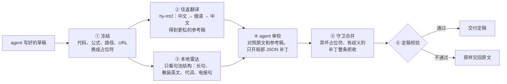

<div align="center">

# 赛博方言去质器 · no-ai-fluff

**少一点机器的体面，多一点人类的直接。**

中文 · [English](README.en.md)


[](https://github.com/user-attachments/assets/c31fbac7-0c2a-4eb0-a31d-aaffb27634c9)

▶ [观看宣传片（2 分 43 秒）](https://github.com/user-attachments/assets/c31fbac7-0c2a-4eb0-a31d-aaffb27634c9)

[](LICENSE)


</div>


---

## 它是做什么的

大模型生成的长回复，常常每个字都认识，连起来却读不懂：“底座、收口、抓手、闭环”，箭头代替连接词，名词一个接一个往上堆。

**no-ai-fluff 在交付前把这种“AI 方言”改回大白话。** 它接在 Claude Code 这类 agent 上：主会话照常写；写完后交给它过一遍，再把定稿给你。代码、公式、路径和数字一个不动。

### 改之前，改之后

> **原文**（为演示写的典型段落）
>
> 本次缓存网关重构以 `SingleFlight` 为底座收口回源请求，打通 `L1/L2` 两级缓存的失效闭环：读请求 → 本地命中 → 远端兜底 → 回填，契约门禁前置，冒烟全绿，`p99 < 15ms`，显著降低调用方心智负担。

> **no-ai-fluff 定稿**（当前默认规则真实跑出的结果，5 处修改，0 处被拒）
>
> 这次缓存网关重构用 `SingleFlight` 统一处理回源请求，并让 `L1/L2` 两级缓存的失效流程完整走通：读请求先看本地缓存是否命中，没命中再由远端兜底，最后回填；契约门禁放在前面，冒烟测试全部通过，`p99 < 15ms`，调用方明显省心不少。

6 个包装词去掉了 5 个（“契约门禁”留了下来），箭头链 3 → 0，`SingleFlight`、`L1/L2`、`p99 < 15ms` 原样保留。

### 为什么会有“AI 方言”

Clark 等人 2026 年的论文《[Why is AI-generated language so hard to understand?](https://arxiv.org/html/2610.29162v1)》发现：后训练越多，模型越爱用难懂的压缩写法；在小模型上做强化学习并加入长度惩罚，它会稳定地偏向更短的句式；把文本翻成外语再翻回来，意思不变，这些难懂的写法会明显变少。

no-ai-fluff 就是把“翻译一圈”这个办法做成了工具。往返翻译会走样，所以翻回来的稿子只当参考，真正改稿的是你的 agent，它只在原文上做局部修改。

### 怎么工作



对 agent 来说只有两次调用（MCP 工具）：

```
prepare_rtt_draft(text)                  → draft_id、原文、往返参考稿、雷达提示、审校规则
finalize_patched_delivery(id, patches)   → 定稿
```

本地雷达不内置黑话词表，只看句法和统计结构：长句、散装英文、代词过密，以及被逗号切成一串短片段的“电报句”。

雷达扫到电报句时，`prepare_rtt_draft` 会先多问一步：请 agent 判断这几句是不是技术/工程语境，再带上 `draft_id` 和 `domain_triage` 调一次。是技术语境，就走强化规则；不是，就走基础规则。这一步也用 agent 自己的模型，往返翻译不会重跑，普通稿子不会触发。

改稿使用 agent 当前登录的模型，在独立子上下文中完成，不占主会话。no-ai-fluff 自己只调用一个便宜的翻译小模型。

### 句式雷达只检查句式、结构，不用写死的黑话词表正则化。

- **压缩方言是句法现象。** Clark 等人（2026）发现，后训练、尤其是带长度惩罚的强化学习，会把模型推向更短、更密的写法。在语料里，我们看到的就是：
  - 虚词和连接词被抽掉；
  - 多步因果压成 `→` 箭头链，或压成不带连接词的短分句；
  - 英文里则是动作藏进 -tion、-ment 名词，再叠上一长串定语。
- **人读这种句子要自己脑补逻辑。** 心理语言学的均匀信息密度（UID）假说认为，读者靠虚词和连接词把信息密度铺平。虚词太少、句子又碎，读者就得在工作记忆里自己补“因为、然后、所以”。
- **所以雷达只量骨架。** 它零成本测量片段数、片段长度和虚词占比，比如中文一句至少 24 字、切成 4 段以上、平均每段 5～11 字、虚词占比不超过 4%，就标成电报句。这类信号跨领域都稳定。
- **具体的黑话词交给翻译往返RTT和宿主。** 黑话一直在变，词表永远追不上；同一张词表既驱动改写、又用来算分，评测就成了照着词表刷分。真术语往返翻译后基本不变，生造的包装词常被洗成直白说法，宿主再据此判断改不改。

详见 [架构设计](docs/architecture.md) 和 [内化规则参考](docs/internalized-rules.md)。

---

## 安装

### 推荐：让 agent 帮你装

把下面这段话发给 Claude Code（或别的能跑命令的 agent）：

```text
请按照 https://github.com/ConstantlyGrowup/no-ai-fluff/blob/main/docs/agent-setup.md 的步骤，
在当前项目里安装 no-ai-fluff（中文版），并帮我配置翻译用的 API Key。
```

agent 会装好命令行工具，注册 MCP Server，安装审校子智能体和 `/no-ai-fluff` 命令，再向你要一个 API Key，写进 `.env`。最后用一段示例文本运行，确认往返翻译确实生效。

用的不是 Claude Code 也没关系。安装指南会让 agent 先认出自己是哪个产品（Codex、Qoder、WorkBuddy、ZCode、DeepSeek Harness 等），再把通用 Skill 装到它读得到的目录，并在 `AGENTS.md` 里加一段说明。

### 你需要准备一个 API Key

翻译小模型 hy-mt2 有两个来源，**推荐 OpenRouter**：

| | OpenRouter（推荐） | 腾讯云 TokenHub（备选） |
|---|---|---|
| 模型 | `tencent/hy-mt2-30b-a3b` | `hy-mt2-pro` |
| 环境变量 | `OPENROUTER_API_KEY` | `TENCENTCLOUD_API_KEY` |
| 限制 | 程序默认 8 路并行翻译，评测中未遇到限流 | 默认每分钟 60 次调用，并发一高就排队；单次输入约 1,200 字，长文要切成更多小块 |
| 费用 | 往返翻译平均约 0.002 美元/篇（封存测试集 30 篇实测） | 以腾讯云计费为准 |

两者都配置时优先用 OpenRouter；读不到 OpenRouter 的 Key 时，才自动改用腾讯云。

**获取 OpenRouter Key**

> 📷 注册 OpenRouter → 充值 → 在 <https://openrouter.ai/keys> 创建 Key
> 
> 
> 


**获取腾讯云 Key**

> 📷 ：开通腾讯云 TokenHub 的 hy-mt2-pro → 创建 API Key
> 
> 
> 
> 


### 手动安装

需要 Python 3.10 及以上，运行时不依赖任何第三方包。

```bash
pip install "git+https://github.com/ConstantlyGrowup/no-ai-fluff.git"
no-ai-fluff install claude-code            # 在当前项目装好子智能体、/no-ai-fluff 和 .mcp.json
echo "OPENROUTER_API_KEY=sk-or-..." >> .env # 或 TENCENTCLOUD_API_KEY=...；.env 不要提交
```

重启 Claude Code，并同意加载项目里的 `no-ai-fluff` MCP Server。之后写完长回复或文档，输入 `/no-ai-fluff`，或者直接说“用 no-ai-fluff 定稿”。

其他 agent 把第二行换成对应的命令，再在那个 agent 里注册 MCP Server（stdio，命令 `no-ai-fluff`，参数 `mcp`）：

| Agent | 命令 | Skill 装到 |
|---|---|---|
| Codex | `no-ai-fluff install codex`，再运行 `codex mcp add no-ai-fluff -- no-ai-fluff mcp` | `.agents/skills/`，另在 `AGENTS.md` 加一段 |
| ZCode | `no-ai-fluff install zcode` | `.agents/skills/`，另在 `AGENTS.md` 加一段 |
| Qoder | `no-ai-fluff install qoder` | `.qoder/skills/`，另在 `AGENTS.md` 加一段 |
| WorkBuddy | `no-ai-fluff install workbuddy` | `~/.workbuddy/skills/`（只支持用户级） |
| DeepSeek Harness 等其他 agent | `no-ai-fluff install generic` | `.agents/skills/`，另在 `AGENTS.md` 加一段 |

> 审校质量很依赖模型的推理强度。实验里同一批稿子，低推理强度时，5 篇稿子全都漏修了事实错误；改成高推理强度后只剩 1 篇。请让审校子任务以高推理强度运行。

<details>
<summary>命令行、环境变量和 Python 用法</summary>

```bash
no-ai-fluff run draft.md -o out.md                # 只做往返翻译（不开补丁）
no-ai-fluff prepare draft.md > prep.json          # 第一次调用
no-ai-fluff finalize <draft_id> --patches p.json  # 第二次调用，补丁可以是文件、- 或内联 JSON
no-ai-fluff radar draft.md                        # 只看本地雷达统计
no-ai-fluff mcp                                   # 启动 stdio MCP Server
claude mcp add no-ai-fluff -- no-ai-fluff mcp     # 只注册 MCP Server
```

| 变量 | 默认值 | 说明 |
|---|---|---|
| `NO_AI_FLUFF_PROVIDER` | 自动 | `openrouter` 或 `tencent`；不设时有 OpenRouter Key 就用它，否则用腾讯云 |
| `NO_AI_FLUFF_MODEL` | 随服务商 | OpenRouter 默认 `tencent/hy-mt2-30b-a3b`，腾讯云默认 `hy-mt2-pro` |
| `NO_AI_FLUFF_BRIDGE` | `ru` | 桥接语：`ru` / `fr` / `ja` |
| `NO_AI_FLUFF_CHAT_TIMEOUT` / `_DOC_TIMEOUT` | `10` / `60` | 终端回复 / 落盘文档的往返翻译时限（秒） |
| `NO_AI_FLUFF_AUDIT_RULES` | `v16`（即 `v2`） | 审校规则代际：`v2` / `v16` 是结构雷达 + 领域分诊；`v1` / `v8` 是第一代单通道 |
| `NO_AI_FLUFF_TERMS` | 空 | 额外冻结的术语，逗号分隔 |
| `NO_AI_FLUFF_TENCENT_RPM` | `60` | 腾讯云每分钟调用上限，程序内按它限速 |
| `NO_AI_FLUFF_TELEMETRY` | `1` | 设为 `0` 关闭本地统计（只记数字，不记正文） |

```python
from no_ai_fluff import Pipeline

pipe = Pipeline()
prep, fin = pipe.run(draft, reviewer=lambda prompt: my_llm(prompt))  # reviewer 返回 JSON 补丁
print(fin.final_text)
```

英文版是独立的命令 `no-ai-fluff-en`（英文→日语→英文往返），见 [English README](README.en.md)。

</details>

### 在对话里怎么用

装好之后，有两种方式让 agent 把稿子交给 no-ai-fluff：

- **方式 A · 斜杠命令**：在 Claude Code 里写完回复或文档后，输入 `/no-ai-fluff`；要处理某个文件，就输入 `/no-ai-fluff path/to/doc.md`。英文版是 `/no-ai-fluff-en`。
- **方式 B · 直接说一句**：提需求时顺带一句“最后用 no-ai-fluff 过一遍”，或者写完后追问“把上面这段用 no-ai-fluff 改成大白话”。在 Cursor、Codex 等其他支持 MCP 的客户端里也一样，agent 会自己调用 `prepare_rtt_draft` 和 `finalize_patched_delivery` 这两个工具。

定稿交回来之后，如果某一段还是太绕，可以点名让 agent 只把那一段整段重写。这句提示和重写规则写在 Skill 和 `AGENTS.md` 里，也会随 `finalize_patched_delivery` 的返回一起交给 agent，所以不认识 Skill 的 agent 也会照做。下面是一段示意对话：

> **第 1 轮：正常定稿**
>
> **你**：帮我写这次缓存网关重构的 PR 说明，写完用 no-ai-fluff 过一遍。
>
> **Agent**：（先照常写好草稿，再交给 no-ai-fluff：往返翻译一圈拿到参考稿，只在读着费劲的句子上做局部修改，代码和数字由程序核对，最后交回定稿）
>
> 这次缓存网关重构用 `SingleFlight` 统一处理回源请求，并让 `L1/L2` 两级缓存的失效流程完整走通：读请求先看本地缓存是否命中，没命中再由远端兜底，最后回填；契约门禁放在前面，冒烟测试全部通过，`p99 < 15ms`，调用方明显省心不少。
>
> 灰度期间旧客户端走兼容降级兜底，契约门禁前置拦截非法回源，降级链路打通后错误率 `< 0.1%`。
>
> ---
>
> 如果你觉得其中哪一段还是太绕、黑话太重，局部小改不够顺口，可以直接告诉我“整体重写”或者“只重写第 X 段”，我会只针对那一段彻底换种直白写法，代码、公式和数字仍一个不动。

> **第 2 轮：点名整段重写**
>
> **你**：第 2 段关于兼容降级的那几句黑话太密了，按说人话规则帮我整段重写一遍，代码和指标别动。
>
> **Agent**：（按内置的重写规则只重写第 2 段，第 1 段和所有代码、数字保持原样）
>
> 灰度发布期间，旧版客户端改走兼容的降级方案；不合规的回源请求，在入口处就被契约检查拦下。降级这条路走通之后，错误率保持在 `< 0.1%`。

第 1 段是上文“改之前，改之后”里真实跑出的定稿；第 2 段和第 2 轮的重写是为演示编写的。重写只在你点名时发生，规则写在安装到项目里的 `/no-ai-fluff` 命令中：只改点名的部分，代码、公式、数字一字不动，不补原文没写的内容。

---

## 评测

评测主要在中文语料上做：76 篇真实长回复，分成训练 22 篇、调参 24 篇、封存测试 30 篇。规则的设计和取舍只用训练集、调参集和探针，封存测试集在调参结束前一直锁着。它一共跑过两次：第一代规则（v8）定版时一次，换成当前默认的第二代规则（v16）后又一次。下面的数字除特别注明外，都是第二代规则在封存测试集上的结果（`benchmarks/results/holdout-v16`）。

评委是第三方模型 JEV（`typesafe/jev-1.14`），每一对都交换前后顺序各判一次，再取平均；另外做了人工盲测。

### 总览

| 指标（封存测试集 30 篇） | 原文 | Humanizer-zh | no-ai-fluff |
|---|---|---|---|
| 对原文胜率 | – | 60.2% | **65.2%**（95% CI 61.3%～69.0%） |
| 比原文好读的篇数 | – | 24 / 30 | **27 / 30** |
| 易读度（1～5） | 4.03 | 4.06 | **4.11** |
| AI 腔概率（越低越好） | 0.451 | **0.397** | 0.424 |
| 保真风险（越低越好） | – | 0.570 | **0.526** |

综合奖励 R 是 **0.656**（95% CI 0.632～0.681）。第一代是 0.641，两代的配对差值 CI 为 +0.001～+0.032，不跨 0，但下沿贴近 0。

### 比原文好读

在封存测试集的 30 篇里，**27 篇改完比原文好读，对原文胜率 65.2%**。人工盲测时，把原文、no-ai-fluff 和 Humanizer-zh 三个版本放在一起，选最好读的一篇，**no-ai-fluff 的首选率是 87.5%**。

| 场景 | 相比 AI 原文的胜率 | 对 Humanizer-zh 的胜率 |
|---|---|---|
| 写作（方案、周报、汇报） | **77.2%** | **57.1%** |
| 编程（PR 总结、代码改动说明） | **71.6%** | **59.6%** |
| 技术讲解（原理、概念、面试题） | **67.8%** | **58.2%** |
| 讨论（技术选型、利弊分析） | **60.3%** | 45.3% |
| 公式推导（带公式的数学、算法推导） | **60.0%** | **61.1%** |
| 日常问答（生活建议） | 54.0% | 41.9% |

### 代码和公式一个不动

| | no-ai-fluff | Humanizer-zh |
|---|---|---|
| 代码、路径、公式、URL 原样保留 | **每篇 100%** | 99.1%，最差一篇只剩 88.9% |
| 数字被改动的篇目 | 1 篇（删掉了一处重复的括注，数值没变） | 2 篇 |

### 黑话：只作侧面观察

运行时的雷达已经不带静态黑话词表。如果再用同一张词表统计“黑话降了多少”，就成了左脚踩右脚的自证，所以黑话计数只作粗略的侧面观察，不作跑分标准。判断好坏，以盲评胜率、易读度和保真风险为准。

| 侧面观察 | 原文 | Humanizer-zh | no-ai-fluff |
|---|---|---|---|
| 6 个高频黑话（沉淀、闭环、抓手、底座、打通、心智） | 17 | 15 | 1 |
| 解释性箭头（`A → B → C` 代替连接词） | 16 | 14 | 5 |

第一行统计调参集和封存测试集共 54 篇，第二行统计封存测试集 30 篇。第一代规则的雷达按词表逐词点名，这两行分别是 0 和 2；第二代不再这么做，典型包装词大多被往返翻译的RTT处理和宿主自然消掉，但不保证清零。

### 和 Humanizer-zh 比

在同一个模型上运行 [Humanizer-zh](https://github.com/op7418/Humanizer-zh)，JEV 判定 **no-ai-fluff 占上风：胜率 53.9%（95% 置信区间 49.1%~58.8%），30 篇里 19 篇占优**

no-ai-fluff 在编程、技术讲解、写作和公式混排上领先；讨论和日常问答则是 Humanizer-zh 更好。no-ai-fluff 的保真风险也更低（0.526 对 0.570），AI 腔概率则略高（0.424 对 0.397）。

差别在做法：Humanizer-zh 整篇重写，no-ai-fluff 只改读着费劲的地方，所以在代码、公式、术语多的文本上更稳。

完整记录：

- [评测报告](docs/evaluation-report.md)：设置、置信区间、分场景、延迟与成本、局限
- [翻译模型与桥接语选型](docs/rtt-model-comparison.md)：为什么是 hy-mt2 + 俄语
- [调优账本](benchmarks/optimization_ledger.jsonl)：每一轮改动和结果
- [英文版评测说明](docs/english-evaluation-report.md)


---

## 原理与文档

- [架构设计](docs/architecture.md) · [内化规则参考](docs/internalized-rules.md) · [给 agent 的安装说明](docs/agent-setup.md)
- 论文：Clark, Martin & Mahowald, 2026, *Why is AI-generated language so hard to understand?*（[arXiv 2610.29162](https://arxiv.org/html/2610.29162v1)）

如果它让你少读了几段黑话，欢迎点个 ⭐。

## License

MIT
