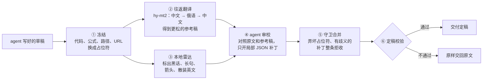

<div align="center">

# 赛博方言去质器 · no-ai-fluff

**少一点机器的体面，多一点人类的直接。**

中文 · [English](README.en.md)

<!-- TODO(作者)：把 promo/no-ai-fluff.mp4 拖进 GitHub 网页编辑器，得到 https://github.com/user-attachments/assets/... 链接后，替换下面两处 VIDEO_URL_ZH -->
[](VIDEO_URL_ZH)

▶ [观看宣传片（2 分 43 秒）](VIDEO_URL_ZH)

[](LICENSE)


</div>

---

## 它是做什么的

大模型生成的长回复，常常每个字都认识，连起来却读不懂：“底座、收口、抓手、闭环”，箭头代替连接词，名词一个接一个往上堆。

**no-ai-fluff 在交付前把这种“AI 方言”改回大白话。** 它接在 Claude Code 这类 agent 上：主会话照常写；写完后交给它过一遍，再把定稿给你。代码、公式、路径和数字一个不动。

### 改之前，改之后

> **原文**（为演示写的典型段落）
>
> 本次缓存网关重构以 `SingleFlight` 为底座收口回源请求，打通 `L1/L2` 两级缓存的失效闭环：读请求 → 本地命中 → 远端兜底 → 回填，契约门禁前置，冒烟全绿，`p99 < 15ms`，显著降低调用方心智负担。

> **no-ai-fluff 定稿**（锁定配置真实跑出的结果，5 处修改，0 处被拒）
>
> 这次缓存网关重构，用 `SingleFlight` 统一处理回源请求，把 `L1/L2` 两级缓存的失效链路串起来：读请求先查本地缓存，本地没命中再由远端兜底，最后回填；契约检查提前卡住，冒烟测试全部通过，`p99 < 15ms`，调用方需要操心的明显少了。

黑话 6 处 → 0，箭头链 3 → 0，`SingleFlight`、`L1/L2`、`p99 < 15ms` 原样保留。

### 为什么会有“AI 方言”

Clark 等人 2026 年的论文《[Why is AI-generated language so hard to understand?](https://arxiv.org/html/2610.29162v1)》发现：后训练越多，模型越爱用难懂的压缩写法；在小模型上做强化学习并加入长度惩罚，它会稳定地偏向更短的句式；把文本翻成外语再翻回来，意思不变，这些难懂的写法会明显变少。

no-ai-fluff 就是把“翻译一圈”这个办法做成了工具。往返翻译会走样，所以翻回来的稿子只当参考，真正改稿的是你的 agent，它只在原文上做局部修改。

### 怎么工作



对 agent 来说只有两次调用（MCP 工具）：

```
prepare_rtt_draft(text)                  → draft_id、原文、往返参考稿、雷达提示、审校规则
finalize_patched_delivery(id, patches)   → 定稿
```

改稿使用 agent 当前登录的模型，在独立子上下文中完成，不占主会话。no-ai-fluff 自己只调用一个便宜的翻译小模型。

---

## 安装

### 推荐：让 agent 帮你装

把下面这段话发给 Claude Code（或别的能跑命令的 agent）：

```text
请按照 https://github.com/ConstantlyGrowup/no-ai-fluff/blob/main/docs/agent-setup.md 的步骤，
在当前项目里安装 no-ai-fluff（中文版），并帮我配置翻译用的 API Key。
```

agent 会装好命令行工具，注册 MCP Server，安装审校子智能体和 `/no-ai-fluff` 命令，再向你要一个 API Key，写进 `.env`。最后用一段示例文本运行，确认往返翻译确实生效。

### 你需要准备一个 API Key

翻译小模型 hy-mt2 有两个来源，**推荐 OpenRouter**：

| | OpenRouter（推荐） | 腾讯云 TokenHub（备选） |
|---|---|---|
| 模型 | `tencent/hy-mt2-30b-a3b` | `hy-mt2-pro` |
| 环境变量 | `OPENROUTER_API_KEY` | `TENCENTCLOUD_API_KEY` |
| 限制 | 程序默认 8 路并行翻译，评测中未遇到限流 | 默认每分钟 60 次调用，并发一高就排队；单次输入约 1,200 字，长文要切成更多小块 |
| 费用 | 往返翻译平均约 0.002 美元/篇（封存测试集 30 篇实测） | 以腾讯云计费为准 |

两者都配置时优先用 OpenRouter；读不到 OpenRouter 的 Key 时，才自动改用腾讯云。

**获取 OpenRouter Key**

<!-- TODO(作者)：补 OpenRouter 注册、充值、创建 API Key 的截图（2～3 张） -->
> 📷 截图待补：注册 OpenRouter → 充值 → 在 <https://openrouter.ai/keys> 创建 Key

**获取腾讯云 Key**

<!-- TODO(作者)：补腾讯云 TokenHub 开通 hy-mt2-pro、创建 API Key 的截图和控制台链接 -->
> 📷 截图待补：开通腾讯云 TokenHub 的 hy-mt2-pro → 创建 API Key

### 手动安装

需要 Python 3.10 及以上，运行时不依赖任何第三方包。

```bash
pip install "git+https://github.com/ConstantlyGrowup/no-ai-fluff.git"
no-ai-fluff install claude-code            # 在当前项目装好子智能体、/no-ai-fluff 和 .mcp.json
echo "OPENROUTER_API_KEY=sk-or-..." >> .env # 或 TENCENTCLOUD_API_KEY=...；.env 不要提交
```

重启 Claude Code，并同意加载项目里的 `no-ai-fluff` MCP Server。之后写完长回复或文档，输入 `/no-ai-fluff`，或者直接说“用 no-ai-fluff 定稿”。

> 审校质量很依赖模型的推理强度。实验里同一批稿子，低推理强度时，5 篇稿子全都漏修了事实错误；改成高推理强度后只剩 1 篇。请让审校子任务以高推理强度运行。

<details>
<summary>命令行、环境变量和 Python 用法</summary>

```bash
no-ai-fluff run draft.md -o out.md                # 只做往返翻译（不开补丁）
no-ai-fluff prepare draft.md > prep.json          # 第一次调用
no-ai-fluff finalize <draft_id> --patches p.json  # 第二次调用，补丁可以是文件、- 或内联 JSON
no-ai-fluff radar draft.md                        # 只看本地雷达统计
no-ai-fluff mcp                                   # 启动 stdio MCP Server
claude mcp add no-ai-fluff -- no-ai-fluff mcp     # 只注册 MCP Server
```

| 变量 | 默认值 | 说明 |
|---|---|---|
| `NO_AI_FLUFF_PROVIDER` | 自动 | `openrouter` 或 `tencent`；不设时有 OpenRouter Key 就用它，否则用腾讯云 |
| `NO_AI_FLUFF_MODEL` | 随服务商 | OpenRouter 默认 `tencent/hy-mt2-30b-a3b`，腾讯云默认 `hy-mt2-pro` |
| `NO_AI_FLUFF_BRIDGE` | `ru` | 桥接语：`ru` / `fr` / `ja` |
| `NO_AI_FLUFF_CHAT_TIMEOUT` / `_DOC_TIMEOUT` | `10` / `60` | 终端回复 / 落盘文档的往返翻译时限（秒） |
| `NO_AI_FLUFF_TERMS` | 空 | 额外冻结的术语，逗号分隔 |
| `NO_AI_FLUFF_TENCENT_RPM` | `60` | 腾讯云每分钟调用上限，程序内按它限速 |
| `NO_AI_FLUFF_TELEMETRY` | `1` | 设为 `0` 关闭本地统计（只记数字，不记正文） |

```python
from no_ai_fluff import Pipeline

pipe = Pipeline()
prep, fin = pipe.run(draft, reviewer=lambda prompt: my_llm(prompt))  # reviewer 返回 JSON 补丁
print(fin.final_text)
```

英文版是独立的命令 `no-ai-fluff-en`（英文→日语→英文往返），见 [English README](README.en.md)。

</details>

---

## 评测

评测都在中文语料上做：76 篇真实长回复，分成训练 22 篇、调参 24 篇、封存测试 30 篇。封存测试集在调参结束前一直锁着，最后只跑了一次。评委是第三方模型 JEV（`typesafe/jev-1.14`），每一对都交换前后顺序各判一次，再取平均；另外做了人工盲测。

### 比原文好读

在封存测试集的 30 篇里，**27 篇改完比原文好读；对原文胜率 63.7%**。人工盲测时，把原文、no-ai-fluff 和 Humanizer-zh 三个版本放在一起选最好读的一篇，**no-ai-fluff 的首选率是 87.5%**。

| 场景 | 相比 AI 原文的胜率 |
|---|---|
| 写作（方案、周报、汇报） | **74.6%** |
| 编程（PR 总结、代码改动说明） | **69.9%** |
| 技术讲解（原理、概念、面试题） | **64.6%** |
| 公式推导（带公式的数学、算法推导） | **60.0%** |
| 讨论（技术选型、利弊分析） | 58.9% |
| 日常问答（生活建议） | 54.0% |

### 代码和公式一个不动

| | no-ai-fluff | Humanizer-zh |
|---|---|---|
| 代码、路径、公式、URL 原样保留 | **每篇 100%** | 99.1%，最差一篇只剩 88.9% |
| 数字被改动的篇目 | 1 篇（删掉了一处重复的括注，数值没变） | 2 篇 |

### 黑话和压缩句式少了

| 指标 | 原文 | Humanizer-zh | no-ai-fluff |
|---|---|---|---|
| 6 个高频黑话（沉淀、闭环、抓手、底座、打通、心智） | 17 | 15 | **0** |
| 解释性箭头（`A → B → C` 代替连接词） | 16 | 14 | **2** |

第一行统计调参集和封存测试集共 54 篇，第二行统计封存测试集 30 篇。

### 和 Humanizer-zh 比

在同一个模型上运行 [Humanizer-zh](https://github.com/op7418/Humanizer-zh)，JEV 判定两者**整体打平，no-ai-fluff 略占上风（51.2%）**。no-ai-fluff 在编程、技术讲解和公式混排上领先；写作、讨论和日常问答则是 Humanizer-zh 更好。差别在做法：Humanizer-zh 整篇重写，no-ai-fluff 只改读着费劲的地方，所以在代码、公式、术语多的文本上更稳。

完整记录：

- [评测报告](docs/evaluation-report.md)：设置、置信区间、分场景、延迟与成本、局限
- [翻译模型与桥接语选型](docs/rtt-model-comparison.md)：为什么是 hy-mt2 + 俄语
- [调优账本](benchmarks/optimization_ledger.jsonl)：每一轮改动和结果
- [英文版评测说明](docs/english-evaluation-report.md)

### 已知局限

- 多一次往返翻译，宿主还要输出补丁，端到端比整篇重写慢：封存测试集上延迟中位数约 71 秒（Humanizer-zh 约 34 秒）。
- 很短的回复可能碰上 10 秒的往返翻译时限，这时原样交回原文，不会出错。
- 人工盲测样本小、测试者只有一位，结论还需要更多人工投票确认。

---

## 原理与文档

- [架构设计](docs/architecture.md) · [写作原则（SKILL.md）](SKILL.md) · [给 agent 的安装说明](docs/agent-setup.md)
- 论文：Clark, Martin & Mahowald, 2026, *Why is AI-generated language so hard to understand?*（[arXiv 2610.29162](https://arxiv.org/html/2610.29162v1)）

如果它让你少读了几段黑话，欢迎点个 ⭐。

## License

MIT
