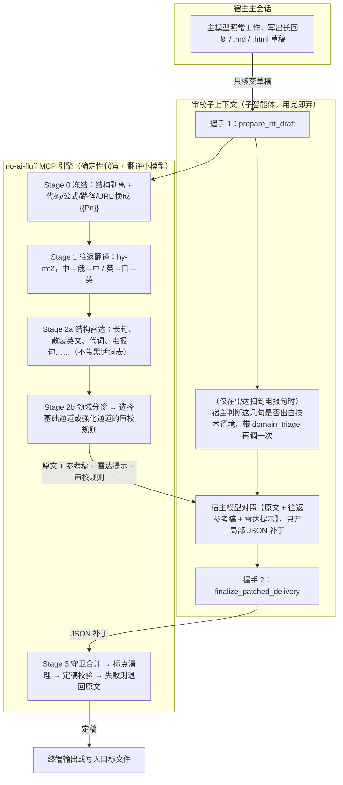
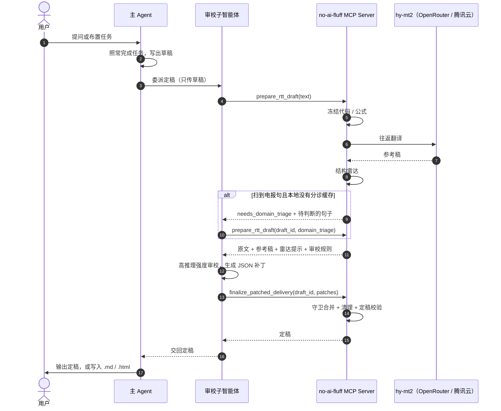

# `no-ai-fluff` 架构

> 一句话：**跨语种往返翻译（RTT）给出一份更松的参考稿，本地雷达只看句式结构；宿主模型在独立子上下文里对照原文和参考稿，只开局部 JSON 补丁；确定性代码负责守卫合并和兜底回退。**
>
> - **不干扰主任务**：主 Agent 照常推理和编码，不需要在主会话里注入长篇文风约束；
> - **额外成本只有一个翻译小模型**：审校借用宿主自己的大模型，在用完即弃的子上下文里完成，不占主会话的上下文；
> - **防止二次压缩**：宿主只能提交局部替换补丁，不能整篇重写，所以不会把往返翻译拆松的句子又压回去。

改写规则的细节（真术语判据、照妖镜、问题类型、补丁守卫）见 [内化规则参考](internalized-rules.md)。

---

## 一、理论依据

### 1. 病因

Clark, Martin & Mahowald（2026）的论文《Why is AI-generated language so hard to understand?》发现三件事：

- 后训练越多，模型越常用难懂的压缩写法；
- 在小模型上做带长度惩罚的强化学习，模型会稳定地偏向更短的句式；
- 把文本翻成外语再翻回来，意思不变，这些难懂的写法会明显变少。

在中文语料里，我们看到的压缩方言主要是这几种：

- 名词连排；
- 用箭头和顿号代替“因为、然后”；
- 抽象名词加跨界动词组成的包装说法（“挂载契约门禁”“控制并发水位”）；
- 被逗号切成一串短片段、几乎没有虚词的“电报句”。

此外还有中英混杂、欧化翻译腔和空洞大词。

### 2. 为什么雷达只看结构

压缩方言的共同点在句法骨架上：虚词和连接词少，句子被切成很多短片段，多步因果被压成箭头链。这些特征能用确定性规则零成本测量，而且跨领域稳定。

具体的黑话词却一直在变，词表永远追不上。而且，如果同一张词表既驱动改写、又用来算分，评测就会变成照着词表刷分。

所以第二代架构的分工是：

- 雷达只测句法骨架和虚词密度；
- 词汇层面的包装黑话，交给往返翻译照妖镜和宿主模型的语义判断。

### 3. 翻译小模型与桥接语选型

- 模型：`tencent/hy-mt2-30b-a3b`（OpenRouter）或 `hy-mt2-pro`（腾讯云 TokenHub）。
- 中文桥接语：俄语。2 个模型 × 3 种桥接语（日、法、俄）的消融和人工盲测里，俄语最常被选中，过程见 [翻译模型与桥接语选型](rtt-model-comparison.md)。
- 英文桥接语：日语，与论文一致；三个翻译模型的对比见 [英文版评测说明](english-evaluation-report.md)。

---

## 二、总体架构



---

## 三、各阶段

### Stage 0：结构剥离与冻结（`masker.py`、`en/masker.py`）

- **结构不送翻译**：
  - Markdown 的围栏代码块、分割线、空行原样直通；
  - 标题、列表、复选框、表格分隔符剥离保护，只取正文槽位；
  - HTML 跳过 `<script>`、`<style>`、`<code>`、`<pre>`、`<svg>` 和标签属性，只处理可见文本节点。
- **冻结为 `{{P0}}`、`{{P1}}`**：行内代码、LaTeX 公式、URL、文件路径、Commit / PR 编号、驼峰和下划线标识符、`O(n)`、`API` 这类工程缩写，以及 `NO_AI_FLUFF_TERMS` 指定的术语。
- **故意不冻结**：`edge case`、`overhead`、`trade-off` 这类日常散装英文，交给往返翻译转成自然中文。

### Stage 1：往返翻译（`rtt.py`、`en/rtt.py`）

- 服务商：
  - 有 `OPENROUTER_API_KEY` 时用 OpenRouter；
  - 否则用腾讯云 `TENCENTCLOUD_API_KEY`，客户端按每分钟 60 次限速，遇到 429 按 Retry-After 退避。
- 翻译方式：
  - 温度 0.1，纯翻译，不向小模型注入风格指令；
  - 每段附带最多 300 字上文；
  - 多段用 `⟦0⟧`、`⟦1⟧` 分界符合并成一批；分界符对不上时降级为单段重试；
  - 单段校验失败时，只把这一段退回原文。
- 时限：终端回复 10 秒，落盘文档 60 秒。超时、未配置 Key、整体失败时，参考稿就用原文，宿主照样可以在原文上开补丁。
- **往返稿只作参考**：它会走样，比如把“运维成本”译成“运营成本”。所以补丁永远打在原文上。

### Stage 2a：结构雷达（`radar.py`、`en/radar.py`）

- 只扫原文的句法和统计结构，结果作为“疑点提示”交给宿主核对，不据此自动改写。
- 中文类别：
  - 长句 / 定语堆积；
  - 散装英文；
  - 密集代词；
  - 电报式短句群：至少 24 字，切成至少 4 段，平均每段 5～11 字，虚词与连接词占比不超过 4%。
- 英文类别：
  - long sentence；
  - noun stack；
  - nominal-heavy；
  - symbol for word；
  - label fragment；
  - telegraphic sentence chain。
- **运行时不跑黑话词表**。词表只留在评测脚本里，做事后统计。

### Stage 2b：领域分诊与双通道门控（`telegraph_router.py`、`patcher.py`、`en/rules.py`）

- 雷达没扫到电报句：走**基础通道**，审校提示词与第一代单通道规则逐字相同。
- 扫到电报句：`prepare_rtt_draft` 先返回这几句，请宿主判断是否出自技术/工程语境。宿主带 `draft_id` 和 `domain_triage` 再调一次，往返翻译不重跑。
  - 至少一句是技术语境 → **强化通道**：增加真术语判据、往返稿照妖镜、[电报堆叠] 类型；
  - 全部不是（旅游攻略、生活叮嘱等误报）→ 去掉电报提示，走基础通道。
- 判断结果按“分诊版本 + 模型 + 句子 sha256”缓存在本地，同样的句子以后不再问。
- 生产路径不调用任何外部分诊 API。评测脚本可以显式注入 DeepSeek 分诊器。

### Stage 2c：宿主审校（独立子上下文）

- 宿主拿到原文、往返参考稿、雷达提示和审校规则，只输出 `[{"find", "replace", "type", "reason"}]`。没有要改的就输出 `[]`。
- 每条补丁必须写明问题类型：
  - 中文基础通道 10 类，强化通道再加 [电报堆叠]；
  - 英文基础通道 11 类，强化通道再加 [telegraph-stack]。
- 审校质量依赖推理强度：同一批稿子，低推理强度时 5 篇里有 5 篇漏修了严重事实错误，高推理强度时只剩 1 篇。

### Stage 3：守卫合并、清理与回退（`patcher.py`、`pipeline.py`、`cleanup.py`）

- 补丁逐条合并。以下情况整条拒收，其余补丁照常生效：
  - `find` 找不到或有歧义；
  - 跨行，或超过 400 字；
  - 弄坏、丢失或复制了 `{{Pn}}`；
  - 改了行首结构或表格列数；
  - `type` 不在允许的类型里。
- 只清理被改写过的槽位：重复标点、两个汉字之间多出来的空格等；原文本来就这样写的不动。
- 定稿校验：解掩码后，所有受保护内容必须一个不少，否则整篇退回原文。
- 遥测：写入 `~/.no-ai-fluff/events.jsonl`，只记录计数，比如雷达命中、补丁生效与拒收、回退原因，从不记录正文。

---

## 四、接入时序（Claude Code）



- **Claude Code**：`no-ai-fluff install claude-code` 会安装三样东西：
  - stdio MCP Server；
  - `.claude/agents/no-ai-fluff.md` 审校子智能体；
  - `/no-ai-fluff` 斜杠命令（`.claude/skills/no-ai-fluff/SKILL.md`）。

  英文版用 `no-ai-fluff-en install claude-code`。
- **其他 MCP 客户端**：注册命令为 `no-ai-fluff mcp`（或 `no-ai-fluff-en mcp`）的 stdio Server。
- **Python**：`Pipeline().run(text, reviewer=...)`。reviewer 先回答分诊提示（如果有），再回答审校提示。

---

## 五、规则版本

只保留两个架构代际，其余实验轮次见 `benchmarks/optimization_ledger.jsonl` 与 git 历史：

| 代际 | 中文 | 英文 | 要点 |
|---|---|---|---|
| 第一代 v1 | `v1` = 账本名 `v8` | `v1` = 账本名 `en2` | 单通道；补丁打在原文上；雷达含静态黑话词表 |
| 第二代 v2（默认） | `v2` = 账本名 `v16` | `v2` = 账本名 `en5` | 结构雷达 + 领域分诊 + 双通道门控；运行时不带黑话词表 |

评测结果见 [评测报告](evaluation-report.md) 和 [英文版评测说明](english-evaluation-report.md)。

---

## 六、仓库结构

```text
no-ai-fluff/
├── README.md / README.en.md
├── docs/
│   ├── architecture.md              # 本文
│   ├── internalized-rules.md        # 内化规则参考
│   ├── agent-setup.md               # 给 agent 的安装说明
│   ├── evaluation-report.md         # 中文评测报告
│   ├── english-evaluation-report.md # 英文版评测说明
│   └── rtt-model-comparison.md      # 翻译模型与桥接语选型
├── src/no_ai_fluff/
│   ├── masker.py      # Stage 0
│   ├── rtt.py         # Stage 1
│   ├── radar.py       # Stage 2a
│   ├── telegraph_router.py  # Stage 2b 领域分诊
│   ├── patcher.py     # 审校规则 + Stage 3 守卫合并
│   ├── cleanup.py     # 定稿标点清理
│   ├── pipeline.py    # 两次握手编排与回退
│   ├── mcp_server.py / cli.py / install.py / telemetry.py
│   ├── adapters/      # Claude Code 子智能体与斜杠命令模板（中 / 英）
│   └── en/            # 英文版：masker / rtt / radar / rules / cleanup / pipeline / mcp_server / cli
├── benchmarks/        # 语料、数据切分、评测脚本、结果与调优账本
├── promo/             # 宣传片（从评测结果生成数据）
└── tests/
```
