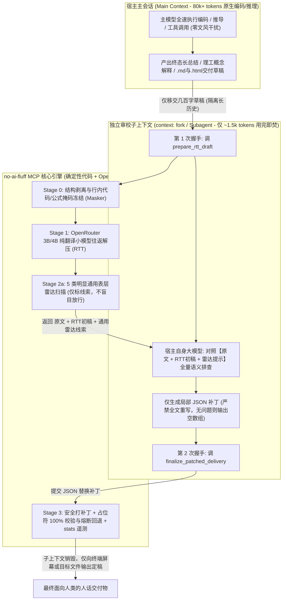
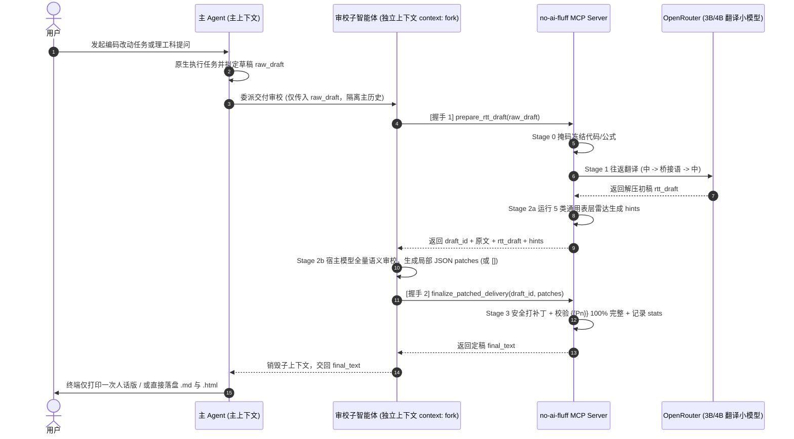

# `no-ai-fluff` 顶层系统架构方案（v2 定稿版）

> **核心设计命题**：基于 **“跨语系小模型往返翻译（RTT）句法粗解压 + 宿主模型独立子上下文（Subagent）全量语义审校与局部 JSON 补丁”** 的交付层语言净化架构。
> - **对主任务轨迹零干扰**：主 Agent 保持原生推理与编码能力，不注入长篇文风约束；
> - **零额外大模型 API 成本**：仅需一个极低成本的 OpenRouter 翻译小模型 API，语义审校 100% 借用宿主自身大模型（运行在用完即焚的独立子上下文中，不消耗主会话长历史额度）；
> - **防大模型二次压缩**：强制宿主模型只输出局部替换 JSON 补丁，保留小模型解压出的自然松弛句式。

---

## 一、理论依据与前置探针结论

### 1. 病因拆解（Clark et al., 2026 & `humanize`）
现代前沿大模型在数学、代码等可验证奖励强化学习（RLVR）与长度惩罚训练下，演化出了违背人类工作记忆与均匀信息密度（UID）的**高压缩方言**（连续名词堆叠、无生命主语配拟人动作动词、生造压缩代号、省略必要连接词），叠加中文语境下的散装中英混排、欧化翻译腔与互联网空洞大词，造成极高的阅读与 Review 负担。

### 2. 语言类型学对照组设计（中文 P0 桥接语选型）
针对中文“左分支超长前置定语（连环‘的’字）+ 汉字复合名词堆叠”的核心病灶，设立三组对照实验（以母语者最终阅读流畅度与语义零失真为唯一胜出标准，不以单纯拆句碎度论优劣）：
- **实验组 A：日语（`ja`）** —— 黏着语 / SOV。断句意愿强，但与中文同属左分支前置定语且共享双字汉字词，易保留连环 `的` 字与生硬汉字直译（如前期单句探针中将 `non-trivial` 译为 `非平凡`）。
- **实验组 B：法语（`fr`，核心破壁组）** —— 屈折语 / SVO / **严格中心语前置（右分支）**。语法级禁止名词直接堆叠、强制保留关系代词（`qui/que` 不可省）、零汉字同形词借用，强迫小模型彻底拆解压缩黑话与长定语（单句探针中将 `edge case` 与 `non-trivial overhead` 自然洗为 `极端情况下` 与 `不可忽视的开销`）。
- **参考组 C：俄语（`ru`，原论文附录 B.5 对照语种）** —— 六格形态变位显式锁死施事主体、受事客体与工具角色，专治中文主客体指代模糊。

### 3. 翻译小模型对比矩阵
- **`tencent/hy-mt2-30b-a3b`**（MoE 架构，每次激活参数 **3B**，纯机器翻译专用模型，原生中文对齐与分隔符保护，`$0.074/M` 输入）
- **`google/gemma-3-4b-it`**（4B 轻量多语底座，与论文附录 B.5 `TranslateGemma-4B` 同源，`$0.050/M` 输入；前期探针显示其在俄语桥接下偶发专业词幻觉，需在评测台定量对比）

---

## 二、总体系统架构（v2：独立子上下文微创闭环）

系统分为 **宿主主会话层**、**独立审校子上下文层（Isolated Subagent）**、**MCP 核心四阶引擎层** 与 **离线评测盲测台** 四部分：



---

## 三、核心四阶流水线分工明细

### Stage 0：结构感知拆分与确定性掩码层（`Masker`）
1. **结构零触碰剥离**：
   - **Markdown**：围栏代码块（```` ``` ````）、分割线、空行标记为不可翻译，**零 Token 消耗原样直通**；标题（`## `）、列表与复选框（`- [x] `）、表格分隔符剥离保护，仅提取纯正文槽位。
   - **HTML 可视化材料**：跳过 `<script>`、`<style>`、`<code>`、`<pre>`、`<svg>` 及所有标签属性，仅抽取可见自然语言文本节点处理后原地回填。
2. **行内冻结 vs 散装英语暴露**：
   - **强制冻结为 `{{P0}}`, `{{P1}}`**：行内反引号代码、LaTeX 公式、URL、文件路径、Git Commit/PR 编号、驼峰/下划线标识符、复杂度符号 `O(n)`、通用工程大写缩写（`API`、`SDK`、`SQL`、`SSE`、`Mutex` 等）。
   - **故意裸露（免规则清洗）**：非必要的日常散装英语（`edge case`、`non-trivial`、`overhead`、`trade-off`、`fallback`、`critical`、`sync`），交由跨语种往返自动转化为自然中文。

### Stage 1：OpenRouter 原生小模型往返解压层（`RTT`）
- 读取环境变量 `OPENROUTER_API_KEY`，温度 `0.1`，纯翻译模式（不向小模型注入复杂风格指令）。
- 使用段落分界符 `⟦0⟧`、`⟦1⟧` 合并批处理，保留跨句指代上下文，单次千字总结往返耗时控制在 **2~4 秒**；若分界符数量不一致则自动降级为单段重试。

### Stage 2：通用表层雷达 + 独立上下文全量语义微创审校（`Radar + Host Subagent`）
明确划分 **“确定性代码雷达”** 与 **“宿主大模型语义审校”** 的职责边界：

#### Stage 2a：本地确定性雷达（5 类明显且通用的表层/结构规则 —— 仅作辅助高亮与客观统计，绝不盲目放行）
1. **长句与定语堆积预警**：单逗分句长度超阈值（如 `> 40 字`）或单分句内含 `≥ 3 个“的”` 字连环套娃；
2. **数字与量级一致性核对**：提取原文与 RTT 初稿中的阿拉伯数字/百分比集合做差集比对，防止翻译过程漏数字或篡改数值（如 `15秒`、`82.7%` 异变）；
3. **典型高频套话与黑话提示**：匹配最显著的表层起承转合套话（`值得注意的是 / 综上所述 / 总的来说`）及高频空洞黑话（`赋能 / 闭环 / 抓手 / 底层逻辑`）；
4. **散装英文残留提示**：检测正文里未被掩码保护却残留的散装日常英文词；
5. **密集代词风险提示**：单分句或相邻短句重复出现多个 `它 / 其`。

#### Stage 2b：宿主模型（独立子上下文）全量语义排查与 JSON 补丁开具
- **取消盲放行**：无论本地雷达是否报警，每一次 RTT 初稿都交由独立子上下文中的宿主大模型对照 `【原文】` 与 `【RTT 初稿】` 做全量语义审校。
- **重点攻克纯语义病灶**（控制在 `< 800 字` 提示词甜点区内）：
  1. **理工科专业术语校准（遵循标准 A）**：发现任何词表外的专业术语翻偏（如 `正定矩阵 → 积极确定矩阵`、`逃逸分析 → 逃跑分析`、`幂等闸门 → 幂等交换机`）立即修正，且首次出现的硬核学科概念统一按 `中文标准名（English Term）` 括注；
  2. **因果方向与充要条件核查**：修正 RTT 可能造成的语气弱化（如“仅在…时”变成“通常在…时”）、因果倒置或必要中间推理步骤遗漏；
  3. **隐蔽比喻与指代消歧**：将词表外的空间动作隐喻改回直白因果，把指代不明的“它/其”替换为明确的主体和客体名词。
- **只准输出局部 JSON 补丁**：强制格式为 `[{"find": "初稿原片段", "replace": "修改后片段", "reason": "原因"}]`（若语义精准且通顺自然，则输出 `[]`）。**严禁重写全文**，从机制上封死宿主大模型复发 RLVR 压缩病的可能。

### Stage 3：确定性补丁合并、100% 占位符熔断守卫与遥测（`Verifier & Stats`）
- **安全合并补丁**：代码层逐条执行 `find -> replace`，若某条补丁破坏或丢失了 `{{Pn}}` 占位符或反引号代码，自动拒收该条补丁。
- **100% 占位符还原校验**：解掩码并验证所有代码、公式、路径零缺失；一旦校验不通过或整体超时（对话 `> 10s`、文档 `> 60s`），无损回退至原始文本。
- **工程侧 `stats` 遥测**：追加写入 `~/.no-ai-fluff/events.jsonl`，记录触发出口、模型/桥接语耗时、雷达命中项、宿主模型实际开具的补丁条数与回退率。

---

## 四、多宿主无感接入时序（Claude Code 优先）



### 三大目标宿主映射方式
1. **Claude Code（P0 首发适配）**：
   - 注册标准 `stdio` MCP Server（提供 `prepare_rtt_draft` 与 `finalize_patched_delivery`）；
   - 配置带 `context: fork` 的轻量交付 Skill / `.claude/agents/no-ai-fluff.md` 子智能体（复用 Claude Code 当前登录模型，隔离主会话历史）；
   - 可选加挂 `PreToolUse` 落盘守卫钩子，确保面向人类阅读的长篇 `.md` / `.html` 交付物不遗漏净化流程。
2. **Codex CLI**：
   - 挂载同一套 MCP Server，通过 `AGENTS.md` 路由终态长总结与交付文档走委派子任务完成两次握手。
3. **DeepSeek Harness**：
   - 支持挂载 MCP，或直接在 Harness 输出缓冲层调用 Python 核心库：内部自动用同一个 DeepSeek 客户端发起一次无历史的独立单轮 `messages=[...]` 请求生成 JSON 补丁，实现 100% 透明原地替换。

---

## 五、评测与盲测选型方案（沉淀开源报告数据）

为支撑后续技术报告撰写与 GitHub 开源发布，评测分三步闭环：

1. **真实多场景语料库（覆盖 4 大“AI 味”重灾区，严控 API 额度）**：
   - **Coding**：直接采集 GitHub 开源仓库中真实的 Claude Code 中文 PR 总结（含多文件改动背景、根因与验证，零生成开销）；
   - **教学（理工科概念解释）**：中英混杂 + 高密度压缩概念讲解（流形、特征值、协程、内存屏障等）；
   - **写作**：技术规划方案、汇报文档、对外说明（重度互联网大词与连环长定语）；
   - **讨论**：架构权衡（trade-off）、技术路线思辨（重度排比套话与结尾强行升华）。
   - *注：优先复用互联网公开真实任务与模型原始回复；确需补充的样本仅构造精悍真实任务获取原生回复，完整记录出处与上下文。*
2. **全因子选型对比矩阵**：
   - 模型：`tencent/hy-mt2-30b-a3b` vs `google/gemma-3-4b-it`
   - 桥接语：`日语 (ja)` vs `法语 (fr)` vs `俄语 (ru)`
   - 链路消融：`原始输出` vs `纯 RTT 各组合` vs `RTT + 独立上下文 JSON 微创补丁`
3. **三维度评估与盲测台**：
   - **工程与通用表层统计**：占位符 100% 存活率、数字零篡改率、5 类通用表层雷达下降幅度、端到端延迟与单次成本；
   - **LLM 自动双轴盲评**：语义与技术事实保真度（一票否决项） × 中文自然易读度；
   - **本地交互式人工盲测网页（`blind_test_workbench.html`）**：隐去各版本真实身份并随机打乱顺序，供你对比调整前后的真实阅读体感，直接盲选胜出方案并导出选型统计报表。

---

## 六、仓库规划与后续实施里程碑 (`ConstantlyGrowup/no-ai-fluff`)

```text
no-ai-fluff/
├── .gitignore
├── LICENSE
├── README.md                          # 项目动机、论文理论支撑、选型实证与接入指南
├── SKILL.md                           # 前期提炼的 Humanize 核心原则与正反案例基线
├── docs/
│   ├── architecture.md                # 本顶层系统架构方案（v2 定稿）
│   └── evaluation-report.md           # 后续沉淀的模型/桥接语盲测与消融评测报告
├── src/no_ai_fluff/                   # 核心四阶引擎与 MCP Server（零重型第三方依赖）
│   ├── masker.py                      # Stage 0: Markdown/HTML 剥离与 {{Pn}} 掩码还原
│   ├── rtt.py                         # Stage 1: OpenRouter 往返翻译客户端
│   ├── radar.py                       # Stage 2a: 5 类明显通用的表层/数字一致性雷达
│   ├── patcher.py                     # Stage 2b & 3: 独立上下文审校提示词与 JSON 补丁安全合并
│   ├── telemetry.py                   # events.jsonl 运行遥测与 stats 统计表生成
│   ├── pipeline.py                    # 核心编排与超时/异常无损回退
│   └── mcp_server.py                  # 标准 stdio MCP Server (两次握手原子工具)
├── adapters/                          # 多宿主即插即用适配层
│   ├── claude-code/                   # context: fork 子智能体/Skill 配置 + 落盘守卫 Hook
│   ├── codex-cli/                     # MCP 配置与 AGENTS.md 路由说明
│   └── deepseek-harness/              # Python 独立上下文中间件封装
├── benchmarks/                        # 真实语料、2x3 消融实验脚本与本地 HTML 盲测工作台
└── tests/                             # 掩码安全、数字核对、补丁防破坏与熔断回退单元测试
```

### 下一步执行路线（留待后续实施 Session 按序推进）
1. **Milestone 1**：实现 `src/no_ai_fluff/` 核心四阶模块（含 5 类通用雷达 `radar.py` 与 JSON 补丁安全合并 `patcher.py`）及完整单元测试，完成首次规范化 Git 提交。（已完成）
2. **Milestone 2**：构建真实多场景样本集，跑完 `2 模型 × 3 桥接语` 消融实验与独立上下文微创补丁对比，验证消融数据。（已完成，见 `docs/rtt-model-comparison.md`）
3. **Milestone 3**：生成本地交互式内部选型盲测网页，由人工盲测锁定默认翻译小模型与最佳桥接语言组合。（已完成：锁定 hy-mt2 + 俄语桥接 + 高推理强度宿主，见 `docs/rtt-model-comparison.md` 第九、十节）
4. **Milestone 4（SOTA 横向打擂）**：对比 GitHub 最火开源标杆 `op7418/Humanizer-zh`（纯 Prompt 全文改写方案）。
   - **分层抽检**：从评测集中跨场景随机抽取 10 组样本，同台对决（`Original` vs `Humanizer-zh 全文改写` vs `no-ai-fluff 最佳组合`）；
   - **职责解耦的三维评价体系**：
     1. **人类纯感性盲测（核心服务目标）**：人类不承担任何数字和规则统计负担，纯凭阅读直觉给出“哪篇更好读 / 哪个读起来最像人话、最不累”，进行 A/B/C 盲选投票；
     2. **LLM 独立双轴盲评**：第三方评委模型打出保真度与易读度评分，严格执行技术事实错误一票否决；
     3. **自动化客观工程雷达**：脚本全自动统计占位符 100% 存活率、数字零篡改率、5 类表层雷达命中降幅、Token 开销与端到端耗时；
   - 沉淀终极评测报告 `docs/evaluation-report.md`。
5. **Milestone 5**：完成 MCP Server 与 Claude Code（`context: fork` 子智能体 + Hook）、Codex CLI、DeepSeek Harness 多端封装及 `stats` 遥测验证，推送发布至 GitHub。
